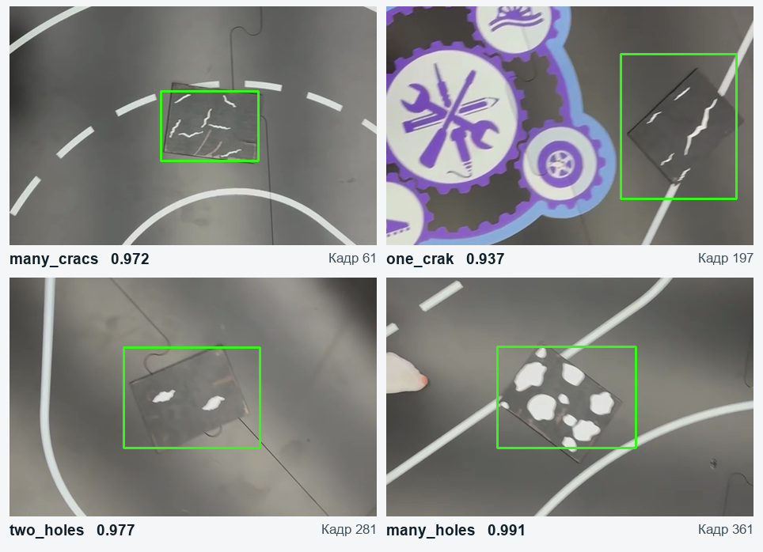
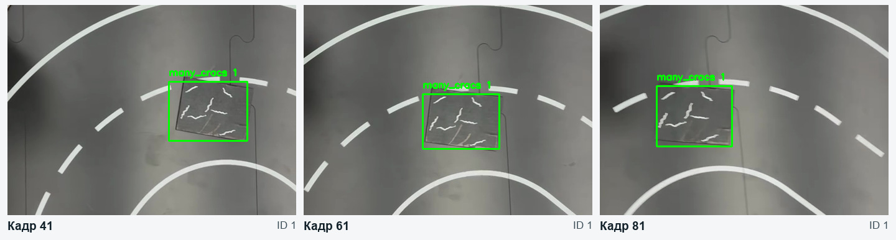
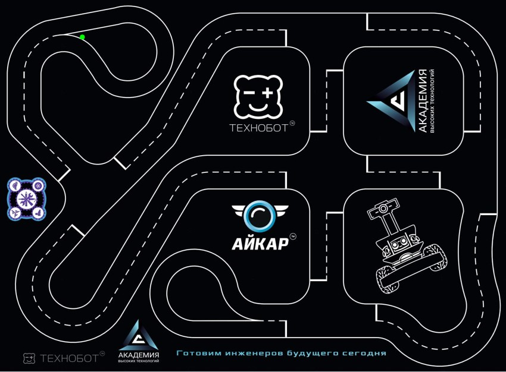

# НТО · Детекция повреждений дорожного покрытия

На видео учебного полигона YOLOv4-tiny находит имитации трещин и выбоин. Скрипт выводит рамку, класс и ID трека поверх кадра, а после просмотра печатает список ID по классам. В проверенном запуске на `IMG_1811.MOV` обработаны **433 кадра**, трекер присвоил **7 ID**.



*Фрагменты кадров 61, 197, 281 и 361 из одной записи. Зелёные рамки и confidence взяты из выхода детектора до трекинга. Нумерация кадров начинается с 1.*

## Как обрабатывается видео

1. OpenCV DNN загружает конфигурацию Darknet и веса с суффиксом `drone`. Скрипт подаёт RGB-изображение 256 × 256 со значениями от 0 до 1. У каждой из двух YOLO-голов четыре класса. В коде используются следующие имена. `many_cracs` — несколько трещин, `one_crak` — одна, `many_holes` — группа выбоин, `two_holes` — две выбоины. [Конфигурация модели](yolov4-tiny-obj_drone.cfg)
2. Детектор использует порог confidence 0,6 и порог подавления пересекающихся рамок (NMS) 0,4. Для трекинга сохраняются рамки площадью **более 100 пикселей² и менее 30% площади кадра**. Центр должен попасть в область размером 60% ширины и высоты кадра.
3. Для каждой рамки скрипт выбирает трек по взвешенному сходству. 40% даёт площадь, 30% — близость к прогнозу центра по двум последним наблюдениям, 30% — корреляция цветовых гистограмм HSV. При сходстве выше 0,8 обновляется лучший подходящий трек, иначе выдаётся новый ID. Класс фиксируется при создании. [Реализация трекера](unic.py)



*Одинаковый фрагмент трёх кадров из окна программы. Рамка следует за группой трещин, сохраняя подпись `many_cracs 1`.*

## Что показал запуск

| Обработка | Вход | Наблюдение |
| --- | --- | --- |
| Основной трекер | [IMG_1811.MOV](IMG_1811.MOV) | Выход детектора непуст в 403 из 433 кадров. По первым меткам треков получено 3 ID `many_cracs`, 1 `one_crak`, 1 `two_holes` и 2 `many_holes`. |
| [Вариант по IoU](tets_yolo.py) | [output4.mp4](output4.mp4) | На 385 кадрах записи экрана при штатных весах и порогах детекций не получено. Используется пара cfg/weights без суффикса `drone`. При confidence от 0,5 и NMS 0,4 остаётся до трёх кандидатов в порядке уверенности. Площадь сравнивается со средней площадью активных рамок (допуск 50%), ID связываются по IoU от 0,3. |

В основном трекере отключено удаление потерянных треков. Старая рамка остаётся на экране, а один физический объект может получить несколько ID. Поля `first_seen` и `last_seen` в этом варианте содержат порядковые значения при создании трека. Разметки для проверки уникальности, precision/recall или mAP в репозитории нет.

## Карта полигона



[map.py](map.py) работает отдельно от YOLO. На плане 8 × 5 м зелёная точка задаётся координатами дрона (1,3 м, 4,5 м). Для красной точки код ищет крупнейший контур Canny на отдельном снимке и пересчитывает смещение в метры с фиксированным масштабом. В поставке отсутствует `frame_001.jpg`, поэтому штатный запуск воспроизводит только зелёную точку. Для дрона и повреждения ось Y преобразуется по-разному. [Архивная карта с красными отметками](damage_map.png) сохранена, исходных наблюдений для проверки этих отметок нет.

## Запуск

Из корня репозитория, в графической сессии. Проверено с Python 3.11 и OpenCV 4.12 на CPU. Обе пары конфигураций и весов включены.

```bash
python3.11 -m venv .venv
source .venv/bin/activate
python -m pip install opencv-contrib-python==4.12.0.88 numpy==2.2.6
python unic.py
```

`Esc` завершает просмотр и печатает статистику. Для варианта по IoU выполните `python tets_yolo.py` (выход — `q`). Команда `python map.py` записывает `result_map.png` в текущий каталог и ждёт нажатия клавиши. Из оставшихся записей `IMG_1812.MOV` и `output6.mp4` читаются, у `output8.mp4` FFmpeg и OpenCV сообщают об отсутствии блока `moov`.

**Навыки для задачи городской инспекции.** Покадровая детекция дефектов, сопоставление наблюдений во времени и проверка реестра по исходным кадрам. Для переноса на автомобильную съёмку понадобятся дорожная разметка для оценки качества, работа с потерей трека и привязка снимка к координатам маршрута.
